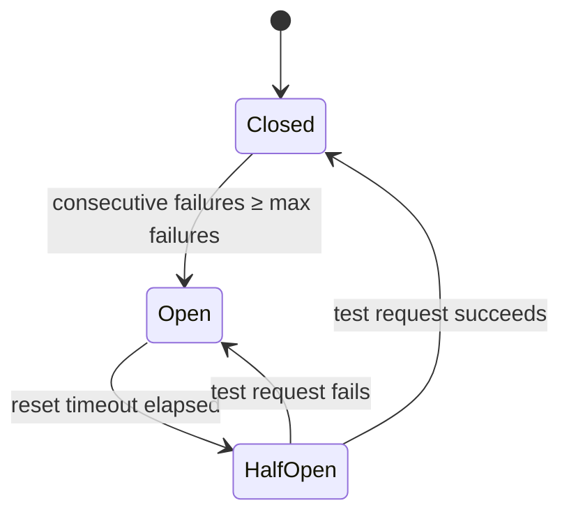

SMS, WhatsApp, and mobile data delivery receipts use a circuit breaker per callback URL. If your endpoint stays down, Belio opens the circuit and skips further posts to that URL until it tries again.

## States

Each callback URL has its own breaker:

| State     | Behaviour                                                                                           |
| --------- | --------------------------------------------------------------------------------------------------- |
| Closed    | Callbacks are delivered as usual.                                                                   |
| Open      | Callbacks to this URL are skipped. Belio does not contact your endpoint.                            |
| Half-open | One test callback is attempted. Success closes the circuit. Failure re-opens it with a longer wait. |

## Configuration

| Parameter            | Default      | Description                                                                                   |
| -------------------- | ------------ | --------------------------------------------------------------------------------------------- |
| Max failures         | `5`          | Consecutive failures within a call timeout window before the circuit opens                    |
| Reset timeout        | `1 minute`   | How long the circuit stays open before moving to half-open and sending a test request         |
| Max reset timeout    | `10 minutes` | Cap on the reset timeout, however many times backoff has multiplied it                        |
| Backoff factor       | `2.0`        | Multiplier applied to the reset timeout after each successive failure. 1 min, 2 min, 4 min... |
| Randomization factor | `0.2`        | ±20% jitter on each reset timeout so several URLs do not retry at the same instant            |
| Call timeout         | `5 seconds`  | How long Belio waits for your endpoint before counting the attempt as a failure               |

## Backoff sequence

With the defaults, successive opens wait this long before a test request (jitter not included):

| Open #        | Reset timeout      |
| ------------- | ------------------ |
| 1st           | 1 minute           |
| 2nd           | 2 minutes          |
| 3rd           | 4 minutes          |
| 4th           | 8 minutes          |
| 5th and later | 10 minutes, capped |

<Note>
  The ±20% jitter means a 4-minute timeout lands somewhere between 3 min 12 s
  and 4 min 48 s.
</Note>

## If your endpoint is slow or down

Acknowledge the callback with HTTP 200 and process it later so you stay under the 5-second call timeout.

Each URL has its own breaker. A slow endpoint trips only that URL.

While the circuit is open, receipts for that URL are not delivered. They are not replayed when the circuit closes. Do not treat callbacks as the only record of delivery.
