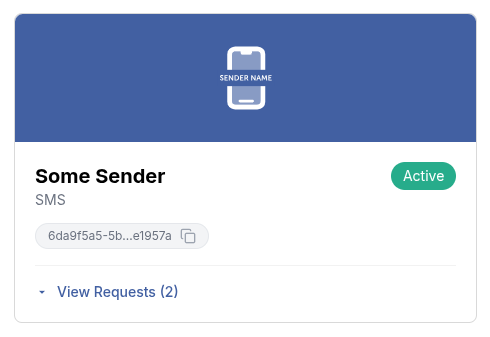
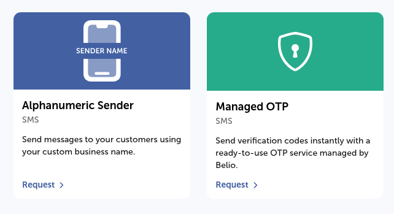

This API enables you to send messages to recipients efficiently while allowing
management and monitoring of message delivery through callbacks.

## Prerequisites

Before you begin, ensure you have:

- A valid and active sms service - You can get one by visiting the [Services](https://cloud.belio.co.ke/services) page
- There are two ways to get a service ID:
  1. Use the [List Services](/service/list) endpoint to list all services and retrieve the ID of the specific one you intend to use
  2. Go to the [Services](https://cloud.belio.co.ke/services) page and copy the ID by clicking on the copy file icon as shown in
the image below.

- API client authorization - This endpoint requires the `message.sms.send.oneway` API client authorization scope to send one way
sms messages. You can set up scopes on the [API Clients](https://cloud.belio.co.ke/team-overview/api-access-keys) page.

## Sender ownership and messaging policy

SMS sender ownership and messaging policy are returned by
[List Services](/service/list). Use `ownership.type` and
`messagingPolicy.type` to determine whether a sender accepts plain text and
which templates it can send.

- **Team-owned** senders are requested for your team. Their messaging policy
  can be `Standard` or `PoliticalCampaign`. Standard team-owned senders accept
  plain-text messages; political campaign senders accept only approved
  political campaign templates.
- **Belio-managed** senders are owned and operated by Belio (for example,
  Managed OTP). They accept managed templates whose scope key matches the
  sender's ownership key; plain-text messages are not accepted.

See [SMS sending](/messaging/sms/send#sender-and-template-eligibility) for the
complete template rules. You can request a service from the
[Services](https://cloud.belio.co.ke/services/services-menu) page.



## Advanced Features

For enhanced functionality, you can include an optional `receiptRequest` in
the request body. This feature allows you to receive delivery receipts for the messages
you send, enabling you to track their status and confirm a successful delivery. The
`receiptRequest` object includes the following fields:

- **correlator**: A unique string to correlate the delivery receipt with the original message.
- **callbackUrl**: A URL where the delivery receipt will be sent.

```bash
curl --request POST \
  --url https://api.belio.co.ke/message/{serviceId} \
  --header 'Authorization: Bearer <token>' \
  --header 'Content-Type: application/json' \
  --data '{
    ...
  "receiptRequest": {
    "correlator": "<string>",
    "callbackUrl": "<string>"
  }
}'
```

By leveraging these features, you can ensure reliable message delivery and gain valuable
insights into the status of your communications.